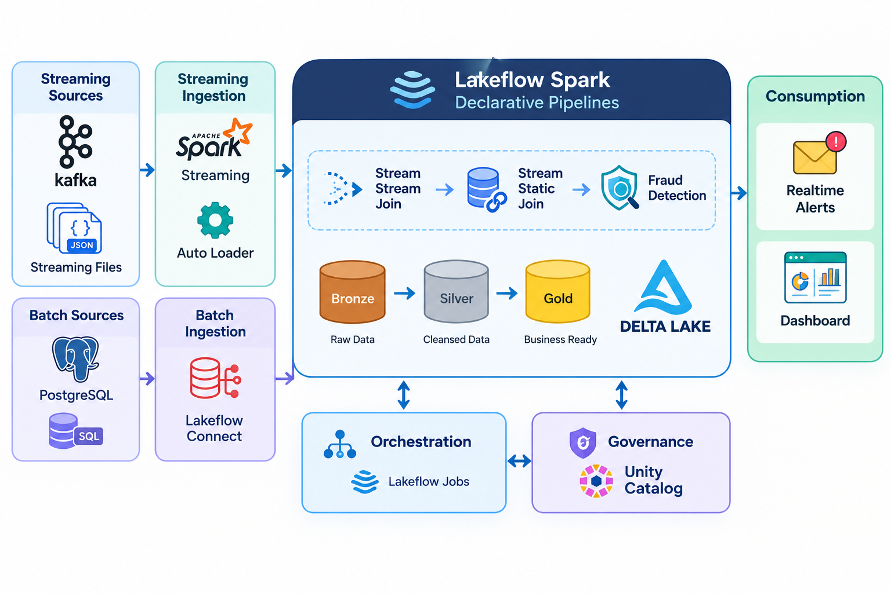
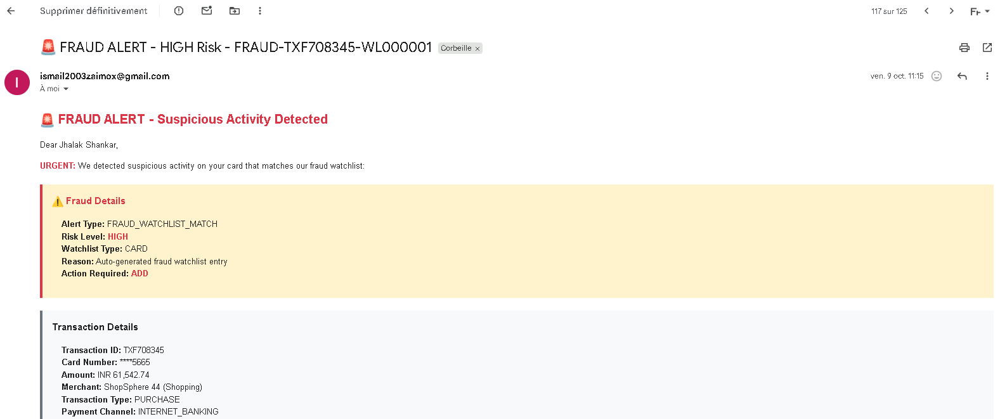
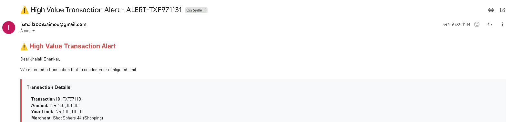
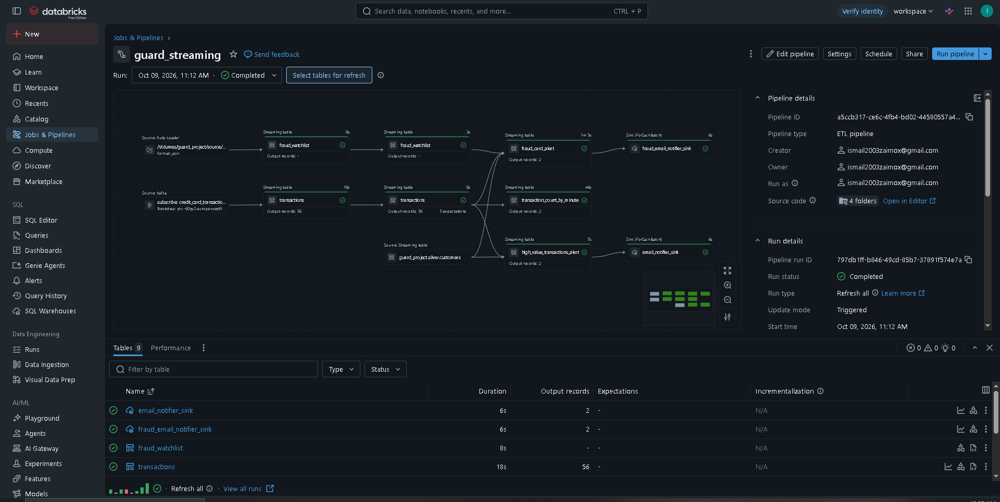
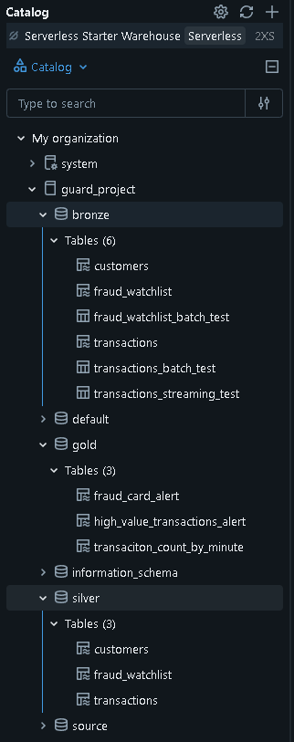

# 🛡️ Guard-Project: Real-Time Fraud Detection Monitoring

An end-to-end **real-time fraud detection pipeline** built on **Kafka** and **Databricks**. Synthetic card transactions are streamed into a **Medallion architecture** (Bronze → Silver → Gold) on Delta Lake, where business rules detect suspicious activity and trigger **real-time email alerts**.

> ⚠️ This project uses **synthetic data** and is a proof of concept for portfolio and learning purposes. It is not a production banking system.

---

## 📌 Highlights

- Real-time ingestion from **Apache Kafka (Confluent Cloud)** with Spark Structured Streaming
- **Medallion architecture** on Delta Lake, built with **Lakeflow Spark Declarative Pipelines**
- **Stream-stream** and **stream-static** joins to enrich transactions with customer and watchlist data
- Data quality rules at the Silver layer (`expect` / `expect_or_drop`)
- 3 Gold detection use cases: fraud card alerts, high-value transaction alerts, transaction count per minute
- Automatic **HTML email notifications** through Gmail SMTP
- Secure credentials handling with **Databricks Secrets**
- Governance with **Unity Catalog**, orchestration with **Lakeflow Jobs**

---

## 🏗️ Architecture



| Layer | Components |
|---|---|
| **Streaming sources** | Kafka topic of card transactions, JSON watchlist files |
| **Streaming ingestion** | Spark Structured Streaming (Kafka), Auto Loader (files) |
| **Batch sources** | PostgreSQL customer reference data via Lakeflow Connect |
| **Processing** | Lakeflow Spark Declarative Pipelines, Bronze → Silver → Gold on Delta Lake |
| **Consumption** | Real-time email alerts (dashboard planned, see Next Steps) |
| **Platform** | Lakeflow Jobs (orchestration), Unity Catalog (governance) |

---

## 🔄 How It Works

1. **Python generators** create synthetic customers, merchants and transactions (normal and fraudulent patterns).
2. Producers publish transactions to a **Kafka** topic.
3. **Bronze**: Databricks consumes the Kafka stream, and Auto Loader ingests fraud watchlist files. Data is stored raw with ingestion metadata.
4. **Silver**: JSON payloads are parsed against explicit PySpark schemas, types and timestamps are normalized, and data quality rules are applied.
5. **Gold**: business rules produce alerts and aggregates (see below).
6. Alerts are sent by **email** as soon as a suspicious transaction is detected.

---

## 🧱 Data Layers

All tables live in the Unity Catalog catalog `guard_project`.

| Layer | Schema | Tables |
|---|---|---|
| Bronze (raw) | `guard_project.bronze` | `transactions`, `fraud_watchlist`, `customers` |
| Silver (cleaned) | `guard_project.silver` | `transactions`, `fraud_watchlist`, `customers` |
| Gold (business) | `guard_project.gold` | `fraud_card_alert`, `high_value_transactions_alert`, `transaction_count_by_minute` |

### Gold use cases

**1. Fraud Card Alert**
Joins Silver transactions with the Silver fraud watchlist (stream-stream join with watermarks), enriches the result with customer data, and raises a high-risk alert when a card matches the watchlist.

**2. High-Value Transaction Alert**
Joins transactions with customer data (stream-static join) and raises an alert when the amount exceeds the customer's configured limit.

**3. Transaction Count by Minute**
Aggregates transactions over one-minute windows with a watermark to monitor transaction volume.

---

## 📧 Alert Notifications

Two notification sinks (`foreachBatch`) send formatted HTML emails through Gmail SMTP.

| Fraud alert | High-value transaction alert |
|---|---|
|  |  |

---

## 📊 Pipeline in Databricks



The `guard_streaming` pipeline connects Kafka and Auto Loader sources to the Silver tables, then to the Gold alert tables and email sinks.



---

## 🧰 Tech Stack

| Technology | Role |
|---|---|
| Python, Faker | Synthetic data generation |
| Apache Kafka / Confluent Cloud | Real-time event transport |
| Databricks, PySpark | Streaming and batch processing |
| Lakeflow Spark Declarative Pipelines | Pipeline definition and data quality expectations |
| Delta Lake | Bronze, Silver and Gold storage |
| Auto Loader | Incremental file ingestion |
| Lakeflow Connect | Batch ingestion from PostgreSQL |
| PostgreSQL | Customer reference data |
| Unity Catalog, Lakeflow Jobs | Governance and orchestration |
| Gmail SMTP | Email notifications |

---

## 📁 Repository Structure

```text
.
├── Databricks/
│   └── guard-project/
│       ├── 01_kafka_streaming_test.py
│       ├── 02_Setup_Secret_Scope.py
│       ├── 03_Send_emails.py
│       ├── 04_Autoloader_test.py
│       ├── guardproject_customers_silver_load/
│       │   └── silver/customers_silver.py
│       ├── guard_streaming/
│       │   ├── bronze/    # transactions_bronze.py, fraud_watchlist_bronze.py
│       │   ├── silver/    # transactions_silver.py, fraud_watchlist_silver.py
│       │   ├── gold/      # fraud_card_alert.py, high_value_transactions_alerts.py,
│       │   │              # transaciton_count_by_minute.py
│       │   └── alert/     # fraud_card_alert_email_notifier.py,
│       │                  # high_value_transaction_email_notifier.py
│       └── guard_watchlist_file_generator/
│           ├── fraud_watchlist.csv
│           └── fraud_watchlist_data_generator.py
├── kafka_producer/
│   ├── data/              # customers.csv, merchants.csv
│   ├── producer_normal.py
│   ├── producer_fraud_transaction.py
│   ├── producer_fraud_card.py
│   ├── customer_generator.py
│   ├── merchant_generator.py
│   ├── transaction_generator.py
│   ├── fraud_engine.py
│   ├── models.py
│   ├── consumer.py
│   ├── config.py
│   ├── .env.example
│   └── requirements.txt
├── postgresql/
│   ├── customers_historic.sql
│   └── customers_incremental.sql
├── docs/images/
└── README.md
```

---

## 🚀 Getting Started

### Prerequisites

- Python 3.9+
- A Kafka cluster (Confluent Cloud works well) with a topic such as `credit_card_transactions`
- A Databricks workspace (the Free Edition is enough to reproduce this project)
- A Gmail account with an app password, for email alerts

### 1. Run the Kafka producers

```bash
cd kafka_producer
python -m venv .venv
source .venv/bin/activate        # Windows: .\.venv\Scripts\Activate.ps1
pip install -r requirements.txt
```

Copy `.env.example` to `.env` and fill in your values:

```env
BOOTSTRAP_SERVERS=your-bootstrap-servers:9092
API_KEY=your_api_key
API_SECRET=your_api_secret
TOPIC_NAME=credit_card_transactions
TRANSACTIONS_PER_SECOND=5
FRAUD_PERCENTAGE=0.08
TOTAL_CUSTOMERS=1000
TOTAL_MERCHANTS=200
RANDOM_SEED=42
```

Start the producers:

```bash
python producer_normal.py              # normal traffic
python producer_fraud_transaction.py   # fraudulent transaction patterns
python producer_fraud_card.py          # targeted fraud-card traffic
```

### 2. Configure Databricks secrets

Create a secret scope named `guard-scope` with two keys:

| Key | Content |
|---|---|
| `kafka_connection_details` | JSON with Kafka connection details |
| `gmail_api_key` | Gmail app password used for SMTP |

```json
{
  "bootstrap_servers": "your-bootstrap-servers:9092",
  "api_key": "your_api_key",
  "api_secret": "your_api_secret",
  "topic": "credit_card_transactions"
}
```

### 3. Load reference data

Run the scripts in `postgresql/` on your PostgreSQL instance, then ingest the customers table into `guard_project.bronze.customers` with Lakeflow Connect.

### 4. Deploy the pipelines

1. Import the notebooks from `Databricks/guard-project/` into your workspace.
2. Generate the fraud watchlist file with `fraud_watchlist_data_generator.py` and upload it to the Auto Loader source volume.
3. Create the two pipelines, `guardproject_customers_silver_load` and `guard_streaming`, and run them.

---

## 🔐 Security Notes

- No credentials are stored in the code. Everything sensitive is read from **Databricks Secrets** or a local `.env` file (which must never be committed).
- Card numbers in alerts are masked (e.g. `****5665`).
- All customer data is synthetic.

---

## ⚠️ Limitations and Next Steps

- Detection is **rule-based**. An ML scoring model (for example trained on labeled fraud data) would be a natural extension.
- Add a **monitoring dashboard** on the Gold tables (alerts, transaction volume per minute).
- Alert history is not persisted for audit purposes yet.
- Add schema contract management for Kafka messages.
- Integrate other channels (SMS, Teams) and deploy on a managed cloud setup.


